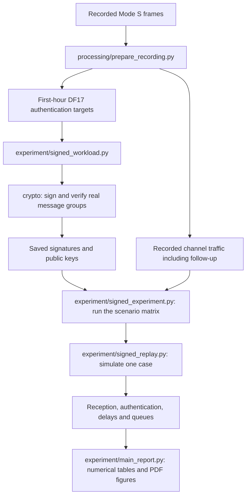

# Where the experiment is implemented

To reproduce the paper, follow the [main README](../README.md). You do not need
to run the files in this folder directly. The numbered commands in `scripts/`
call this code for you.

## Commands and implementation

| Location | Responsibility |
| --- | --- |
| `run_experiment.py` | Starts the complete workflow: preparation, signing, replay, numerical tables and PDF figures, and daytime/nighttime comparison. |
| `scripts/restore_artifacts.py` | Checks that GitHub code matches the Zenodo artifact version and restores the selected raw/prepared/signed inputs. Run it before the experiment. |
| `scripts/01_prepare.py` through `05_compare.py` | Start one of those stages individually. They call the same implementation as the complete workflow. |
| `scripts/06_paper_figures.py` and `07_methodology_figures.py` | Create compact paper figures and methodology diagrams after the scientific results are available. |
| `scripts/08_compare_reference.py` | Compares newly generated numerical tables with the archived reference results without overwriting either. |
| `src/main_experiment.py` | Reads configuration, checks the inputs and saved outputs, and coordinates the selected stages. |
| `src/processing/` | Converts the supplied recordings into the inputs needed by the experiment. |
| `src/crypto/` | Calls the cryptographic libraries to generate keys, sign bytes, and verify signatures. |
| `src/experiment/` | Builds signed workloads, simulates their transmission and reception, and calculates and reports the results. |
| `src/runtime.py` | Prevents conflicting runs and writes output files safely. |
| `scripts/_support/` | Implements command helpers for acquisition, presentation and publication artifacts. These are separate from the scientific replay. |

The word **experiment** names the main scientific implementation. It does not
mean temporary or disposable development code. Automated implementation checks
live in `tests/`.

## Follow a message through the code

Preparation retains the supplied background traffic; it does not sign it all.
The first-hour DF17 messages are the authentication targets. Signature generation
happens once per selected recording, algorithm, and group size. The replay then
reuses those signatures across its transmission-rate, receiver, channel, and
seed scenarios.

## Files by responsibility

| File | What to look here for |
| --- | --- |
| `processing/prepare_recording.py` | Read and validate recordings; create target and channel traces, traffic statistics, and checksums. |
| `crypto/ecdsa_p256.py` | Classical ECDSA P-256 signing and verification. |
| `crypto/ml_dsa_44.py` | ML-DSA-44 signing and verification. |
| `crypto/fn_dsa_512.py` | Falcon-512 signing and verification. `FN-DSA-512` is the historical internal identifier. |
| `crypto/slh_dsa_sha2_128s.py` | SLH-DSA implementation used by validation and diagnostics; not included in the completed full replay matrix. |
| `crypto/common.py` | Utilities shared by the cryptographic implementations. |
| `experiment/signed_workload.py` | Construct signed inputs, generate signatures, and save or validate public signature caches. |
| `experiment/model_support.py` | Form message groups and validate common model settings. |
| `experiment/signed_experiment.py` | Run all requested cases and save their consolidated results. |
| `experiment/signed_replay.py` | Simulate signing, radio scheduling, reception, reconstruction, and verification for one case. |
| `experiment/replay_transport.py` | Encode authentication objects, fragment and reconstruct them, and associate them with received messages. |
| `experiment/shared_channel.py` | Evaluate ordinary-message and authentication-frame reception under the selected channel assumption. |
| `experiment/capture_channel.py` | Apply repeatable random priorities to overlaps involving added authentication traffic. |
| `experiment/channel_trace.py` | Load recorded channel traffic and check its alignment and observation coverage. |
| `experiment/hardware_profiles.py` | Load and validate the reference signing and verification service times. |
| `experiment/delayed_metrics.py` | Calculate reception and authentication coverage, delay, and pending work. |
| `experiment/backlog_intervals.py` | Summarise queue/work intervals using all modeled events. |
| `experiment/resource_preflight.py` | Estimate event volume, resource needs, and host cryptographic runtime before an expensive run. |
| `experiment/replay_artifacts.py` | Load scenarios, fingerprint the experiment, and check saved JSON/CSV consistency. |
| `experiment/result_validation.py` | Check the completed case matrix and metric consistency before reporting. |
| `experiment/main_report.py` | Generate per-window numerical tables, PDF figures, and the daytime/nighttime comparison. |
| `experiment/io_support.py` | Shared file-loading, hashing, backend-loading, and output-durability helpers. |

The `__init__.py` files mark Python packages; they are not additional experiment
steps. Configuration values belong in `config/`, not in the command launchers.
